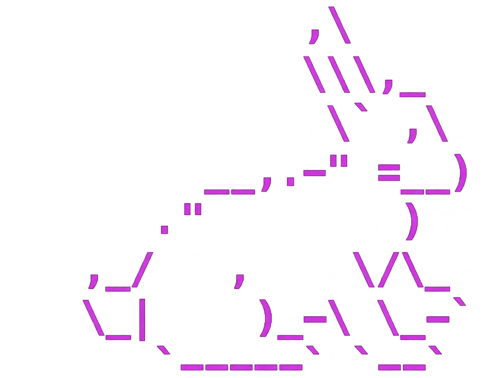
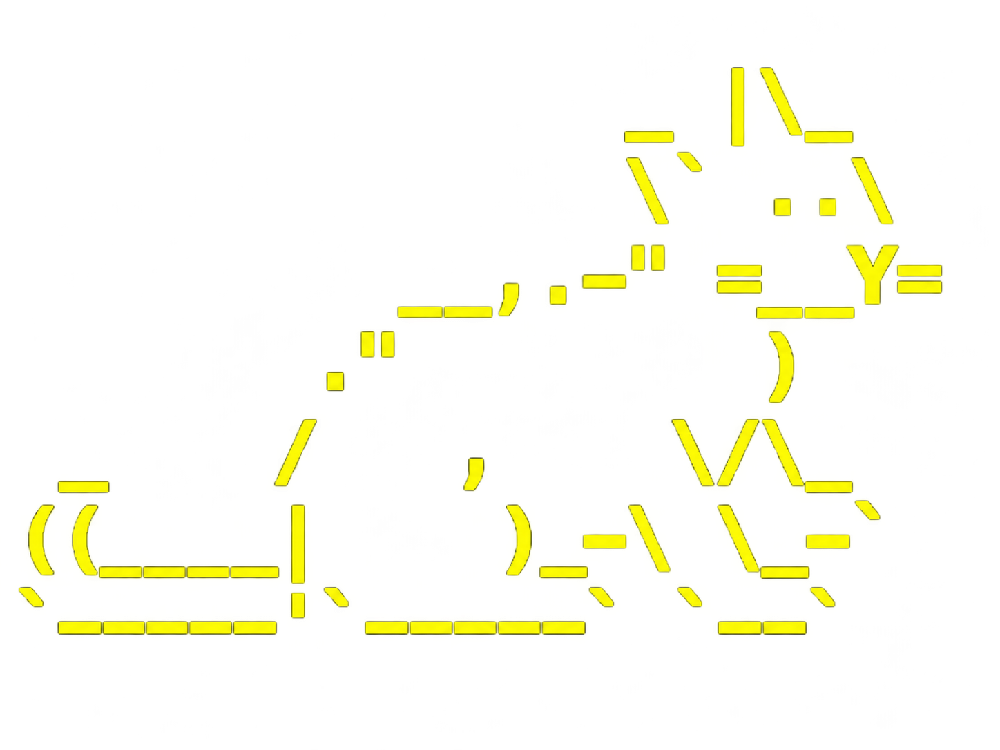
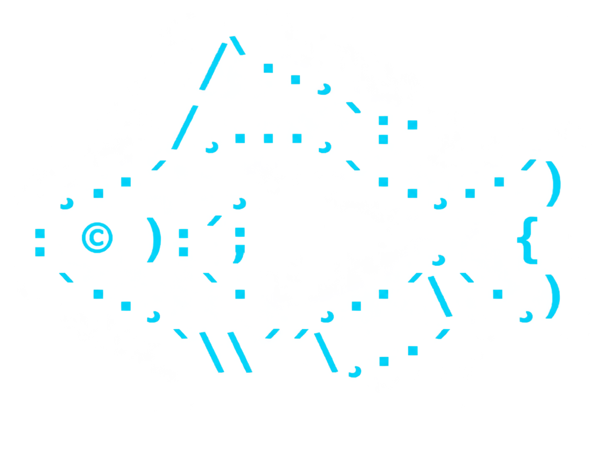

# 🐰 Tamagochi – Virtual Pet Game

A simple virtual pet game programmed in **C**, with a live web dashboard built using HTML, CSS, JavaScript and Node.js.

The game runs in the terminal, while the web application displays the pet's current statistics in real time.

This project was created as a school programming project.

## 📸 Screenshots

### Web Dashboard


### Terminal Game


The game runs directly in the terminal and uses ASCII art to display different animals.

## ✨ Features

### Terminal Game
- Three available pets: Rabbit, Cat and Fish
- Custom pet names
- Colorful ASCII art
- Health, hunger, tiredness and happiness statistics
- In-game money system
- Working to earn money
- Feeding your pet
- Sleeping and resting
- Entertainment activities
- Random events
- Pet illnesses
- Day and turn system
- Saving and loading game progress

### Web Application
- Live pet statistics
- Automatic updates every second
- Pet images based on animal type
- Responsive dark-mode interface
- Colored progress bars
- Money, day and turn counters
- API connection status

## 🛠️ Technologies

| Technology | Usage |
|------------|-------|
| C | Main game |
| libcurl | HTTP communication |
| HTML5 | Web dashboard structure |
| CSS3 | Web dashboard design |
| JavaScript | Fetch API and live updates |
| Node.js | Backend server |
| Express.js | REST API |

## 📁 Project Structure

```text
tamagochi/
│
├── main.c
├── mazlicek.h
├── nova_hra.c
├── nova_hra.h
├── napoveda.c
├── napoveda.h
├── zmena_jmena.c
├── zmena_jmena.h
├── web_api.c
├── web_api.h
│
├── web/
│   ├── server.js
│   ├── package.json
│   └── public/
│       ├── index.html
│       └── photos/
│           ├── rabbit.png
│           ├── cat.png
│           └── fish.png
│
├── screenshots/
│   ├── dashboard.png
│   ├── statistics.png
│   └── terminal.png
│
└── README.md
```

## 🚀 Installation

### 1. Clone the repository

```bash
git clone https://github.com/YOUR_USERNAME/tamagochi.git
cd tamagochi
```

Replace `YOUR_USERNAME` with your GitHub username.

### 2. Compile the C game

On macOS, compile using Clang and libcurl:

```bash
clang main.c nova_hra.c napoveda.c zmena_jmena.c web_api.c -o tamagochi -lcurl
```

Run the game:

```bash
./tamagochi
```

### 3. Install the web server

Navigate to the web directory:

```bash
cd web
npm install
```

If Express is not installed:

```bash
npm install express
```

Start the server:

```bash
node server.js
```

Open the dashboard in your browser:

```text
http://localhost:3999
```

The URL depends on the server configuration.

## 🌐 How It Works

The terminal game and web dashboard communicate using HTTP requests.

```text
       TERMINAL GAME (C)
              |
              |
         HTTP GET
              |
              v
       NODE.JS SERVER
              |
              |
          REST API
              |
              v
       WEB DASHBOARD
       HTML / CSS / JS
```

### Step 1 – Playing the game

The player performs actions such as feeding the pet, sleeping or working.

These actions change the pet's statistics.

### Step 2 – Sending data

The C application uses libcurl to send the pet's current statistics to the server using an HTTP GET request.

Example:

```http
GET /api/update?jmeno=Bunny&druh=kralik&zdravi=85&hlad=60&unava=25&stesti=90&penize=150&den=3&tah=12
```

### Step 3 – Receiving data

The Node.js server receives the request and updates the current pet data.

The API provides the following endpoint:

```http
GET /api/mazlicek
```

Example JSON response:

```json
{
  "jmeno": "Bunny",
  "druh": "kralik",
  "zdravi": 85,
  "hlad": 60,
  "unava": 25,
  "stesti": 90,
  "penize": 150,
  "den": 3,
  "tah": 12
}
```

### Step 4 – Updating the dashboard

The web application uses JavaScript `fetch()` to retrieve the latest statistics every second.

```javascript
const response = await fetch("/api/mazlicek");
const data = await response.json();
```

The dashboard updates automatically without refreshing the page.

## 🐾 Available Pets

| Pet | API Value | Image |
|-----|-----------|-------|
| Rabbit | `kralik` |  |
| Cat | `kocka` |  |
| Fish | `ryba` |  |

Each pet has its own ASCII art in the terminal and an image on the web dashboard.

## 📊 Pet Statistics

| Statistic | Description |
|-----------|-------------|
| Health | The pet's current health |
| Hunger | How hungry the pet is |
| Tiredness | How tired the pet is |
| Happiness | The pet's happiness level |
| Money | Available money |
| Day | Current game day |
| Turn | Current game turn |

Health, hunger, tiredness and happiness use values from 0 to 100.

High hunger and tiredness can negatively affect the pet's health.

## 💾 Saving and Loading

The game supports local saving and loading.

Game progress is saved in:

```text
tamagotchi_save.txt
```

The saved data includes the pet's name, type, statistics, game progress and current condition.

The game can load this file to continue a previous session.

## 🔒 Security Notes

The current API is designed for learning and local or private-network testing.

The update endpoint uses GET requests without authentication.

For public deployment, authentication, input validation and HTTPS should be added. POST or PUT would also be more appropriate for updating server data.

The current server stores statistics in memory, so the data resets when the Node.js process restarts.

## 🔮 Future Improvements

- User accounts
- Multiple pets
- Online game saves
- Database integration
- Historical statistics
- Pet animations
- More random events
- Online interactions with the pet

## 👨‍💻 Author

**stejsky**

School programming project – 2026

**Languages:** C, HTML, CSS, JavaScript

**Project:** Tamagochi – Virtual Pet Game
